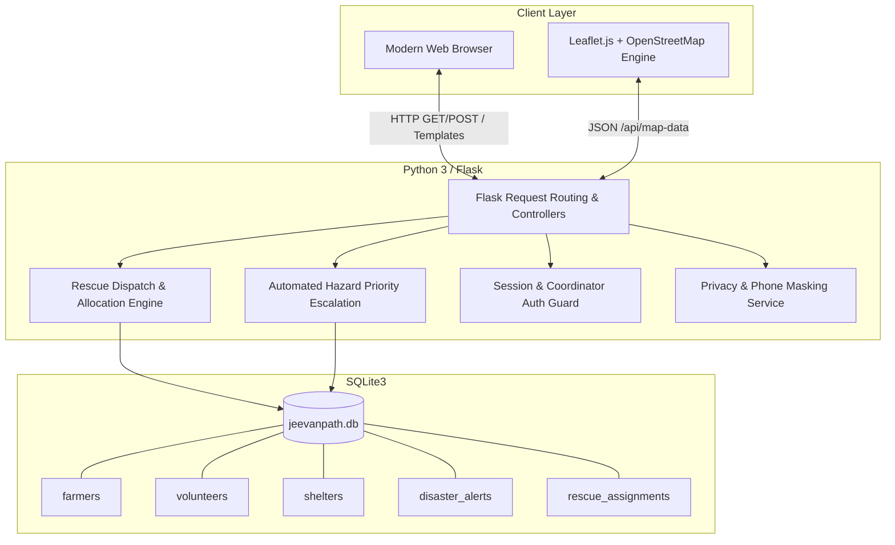
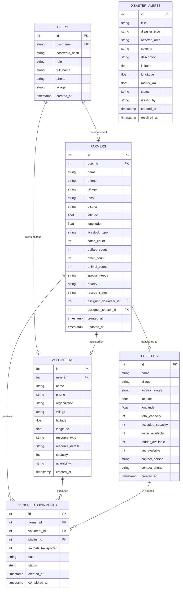
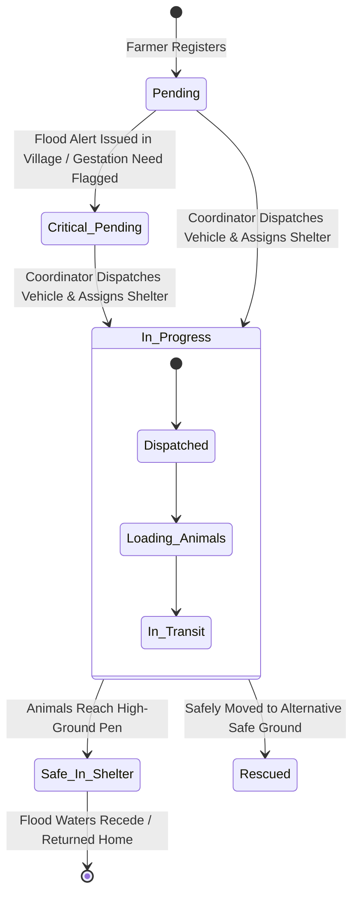

# 📐 JEEVANPATH — Technical Design Document

This document outlines the technical architecture, data model, operational state machine, security considerations, and future scalability roadmap for the **JEEVANPATH Livestock Disaster Rescue and Coordination Platform**.

---

## 1. System Architecture

The system is constructed as a modular Flask application:
- **Presentation Layer:** Server-rendered HTML5 templates via Jinja2 enhanced with custom Vanilla CSS3 (responsive grid, status pills, glassmorphism) and Vanilla JavaScript.
- **GIS Mapping Engine:** Client-side Leaflet.js rendered on top of free, open-access OpenStreetMap tiles. Custom HTML `divIcon` pins represent herds, rescue vehicles, shelters, and threat zones without external binary image dependencies.
- **Business Logic Layer:**
  - *Rescue Coordination Engine:* Handles assignment of transport vehicles to farms and allocation of shelter vacancies with strict capacity verification.
  - *Hazard Priority Escalator:* Automatically parses affected village lists from new flood alerts and escalates priority for farms located in those areas.
- **Persistence Layer:** Embedded SQLite with foreign key enforcement enabled (`PRAGMA foreign_keys = ON`), transactions, and row-factory mapping.

---

## 2. Database Entity-Relationship Schema

---

## 3. Role-Based Access Control (RBAC) Permission Matrix

| Capability / Route | Public Anonymous | Farmer | Volunteer | Rescue Coordinator / Admin |
| :--- | :---: | :---: | :---: | :---: |
| View Mission Dashboard (`/`) | ✅ | ✅ | ✅ | ✅ |
| View Tactical GIS Map (`/map`) | ✅ | ✅ | ✅ | ✅ |
| View Public Directories (`/farmers`, `/volunteers`) | ✅ (Masked PII) | ✅ | ✅ | ✅ (Unmasked PII) |
| User Login (`/login`) & Registration (`/register`) | ✅ | ✅ | ✅ | ✅ |
| Change Password (`/change-password`) | ❌ | ✅ | ✅ | ✅ |
| Farmer Self-Service Portal (`/my-livestock`) | ❌ | ✅ (Own Farm) | ❌ | ✅ |
| Volunteer Resource Portal (`/my-resource`) | ❌ | ❌ | ✅ (Own Unit) | ✅ |
| Rescue Operations Command Board (`/coordinate`) | ❌ | ❌ (403) | ❌ (403) | ✅ |
| Assign Rescue Vehicle & Shelter (`POST /coordinate`) | ❌ | ❌ (403) | ❌ (403) | ✅ |
| Issue / Resolve Disaster Alerts (`POST /alerts/*`) | ❌ | ❌ (403) | ❌ (403) | ✅ |
| Unmask Live Emergency Phone Numbers | ❌ | ❌ | ❌ | ✅ |

---

## 4. Operational State Machine

### Invariant Rules Enforced:
1. **Capacity Guarantee:** A farm cannot be assigned to a shelter if `farm.animal_count > (shelter.total_capacity - shelter.occupied_capacity)`.
2. **Atomic Volunteer State:** When a volunteer is assigned to a farm, their availability shifts to `Deployed`.
3. **Resource Re-release:** When the rescue status transitions to `Safe in Shelter` or `Rescued`, the volunteer's status is automatically restored to `Available`.

---

## 5. Privacy & Security Implementation

1. **Authentication & Password Hashing:**
   - Werkzeug `generate_password_hash` / `check_password_hash` (`pbkdf2:sha256:600000`).
   - Plaintext passwords are never stored in the database or transmitted in log events.
2. **Session Security:**
   - Flask server-side session signed with secret key.
   - `SESSION_COOKIE_HTTPONLY = True` prevents client JavaScript from inspecting session tokens.
   - `SESSION_COOKIE_SAMESITE = 'Lax'` prevents cross-site request forgery via third-party origins.
3. **CSRF Form Hardening:**
   - Double-submit session token validation (`get_csrf_token()`) enforced across all state-mutating POST requests (`/login`, `/register`, `/change-password`, `/coordinate`, `/alerts`, `/farmers`, `/volunteers`).
4. **Phone Number Masking (PII Protection):**
   - In rural flood emergencies, publicly listing women or smallholder farmers' phone numbers leads to harassment, financial scams, or cattle theft.
   - All public views render phone numbers masked:  
     $$\text{mask\_phone}(9876543210) \rightarrow 98^{***}\text{-}^{***}210$$
   - Coordinator Authorization allows authenticated field dispatchers to unmask numbers into direct emergency dialers.
5. **SQL Injection Defense:**
   - 100% of SQLite queries utilize bound parameterized placeholders (`?`). No raw SQL string interpolation is permitted.
6. **Prototype Disclaimer Compliance:**
   - Prominent banners and alert labels prevent false claims of being an official government disaster feed. Real emergencies are redirected to **112 / DDMA**.

---

## 5. Production Scalability & Offline Roadmap

To scale this MVP for pan-India deployment across National Disaster Management Authority (NDMA) and State Disaster Management Authorities (SDMA):

1. **Offline & Feature Phone Accessibility (IVR / USSD / SMS):**
   - Rural cattle owners often use basic 2G feature phones without internet access.
   - Implement an automated toll-free missed-call hotline (e.g. `1800-XXX-XXXX`). Calling triggers an automated voice prompt (IVR in regional languages like Assamese, Bengali, Hindi, Telugu) recording animal headcount and village name.
2. **WhatsApp Bot Integration:**
   - Deploy a lightweight conversational bot via Twilio or Gupshup allowing farmers to register and send their live WhatsApp location pin with a single tap.
3. **Drone & Satellite Flood Extent Feeds:**
   - Ingest Indian Space Research Organisation (ISRO) Bhuvan / Sentinel-1 SAR flood imagery to automatically generate dynamic flood polygons over the Leaflet map.
4. **Offline PWA (Progressive Web App):**
   - Implement service worker caching and IndexedDB synchronization so rescue teams can log rescue actions in areas with disrupted mobile towers and sync once back in network range.
